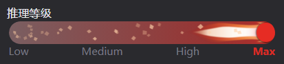

# dsh-ember

[](https://github.com/deepseek-ai/deepseek-harness)
[](#安装--install)
[](LICENSE)

**推理等级变成滑块，完全权限变红。** 两件事，一个插件，不动任何官方组件。

**Reasoning effort becomes a slider; full access turns red.** Two things, one plugin, no shipped component replaced.



<p align="center"><sub>推理等级滑块 · Max 档（暗色主题）<br>Effort slider at the top rung · dark theme</sub></p>

---

## 为什么 / Why

DSH 的 composer 底部有两处可以更好用：

1. **完全权限是灰色的。** 「完全权限」意味着智能体能直接执行敏感操作 —— 删文件、跑命令、改系统。它和「仅可查看」用同一个颜色，视觉上没有任何区别。
2. **推理等级是一串菜单项。** 想从 Low 调到 High，要点开菜单、找到那一行、点它。档位越多找得越慢，而且看不出「现在在整条阶梯的哪个位置」。

这个插件把第一处变红，把第二处变成滑块。

DSH's composer has two spots that could read better:

1. **Full access is grey.** It permits destructive operations — deleting files, running commands, touching the system — yet it looks exactly like read-only.
2. **Effort is a list of menu rows.** Going from Low to High means opening a menu and hunting for the row. More rungs, more hunting, and no sense of where you sit on the ladder.

This plugin repaints the first and turns the second into a slider.

---

## 功能 / Features

### 1. 完全权限变红 / Full access in red

- 「完全权限」的文字和盾牌图标都变成主题红
- **明暗主题都红**，各用 DSH 自带的危险色：亮色 `#ec1313`，暗色 `#f25a5a`
- 只在该预设被选中时红；切回「仅可查看」自动恢复原色
- 确认弹窗里的「启用完全权限」按钮**不会**被误染

- The label and the shield glyph both take the theme's danger colour
- **Red in both themes**, using DSH's own tokens: `#ec1313` light, `#f25a5a` dark
- Red only while that preset is current; switching back restores the neutral tone
- The confirmation dialog's “Enable full access” button is deliberately left alone

### 2. 推理等级滑块 / Reasoning effort slider

打开模型菜单 → 点「推理等级」，那一行下面直接出现一条滑块：

```
┌──────────────────────────┐
│ 模型    Deepseek-V4.1…  ›│
│ 推理等级            High ›│
└──────────────────────────┘
            ↓ 点进
┌──────────────────────────┐
│ [=========|==========]   │  ← 滑块，停在当前档
│ Low       **High**    Max │  ← 档名当刻度，当前档加粗
└──────────────────────────┘
```

- 档位**完全由上游下发决定**：读菜单自身的 `menuitemradio`，不写死
- 1 / 2 / 3 / 4 / 6 档都验证过；少于 2 档时不注入，交回官方列表
- 拖动时刻度**即时高亮**（热更新），松手才提交
- 键盘方向键 / Home / End 同样可用
- 提交走**官方 radio 的 click**，与手点完全同一条写入路径
- 官方 radio 被折叠（CSS 类）而非删除 —— 它们是数据源和写入入口

- Ladder length comes from the menu's own `menuitemradio` rows, never hard-coded
- 1 / 2 / 3 / 4 / 6 rungs verified; below 2 the slider is not injected and the
  shipped list stays
- The scale highlights live while dragging; the write lands on release
- Arrow keys, Home and End work as well
- Commits by clicking the host's own radio — the exact path a user click takes
- The shipped radios are folded with a CSS class, not removed: they are the
  data source and the write entry point

---

## 安装 / Install

```bash
dsh plugin add dsh-ember
```

也可以从源码装：

```bash
dsh plugin add F:/path/to/dsh-ember
```

装完**重启 DSH**。这是纯前端插件，没有服务端逻辑。

Install, then **restart DSH**. It is browser-only; there is no host-side logic.

---

## 兼容性 / Compatibility

| 项 | 要求 |
|---|---|
| DSH | `0.2.1-rc.3`（在 `rc.3` 上开发与验证） |
| 菜单 | `[role="menu"][aria-label="模型与推理等级"]` |
| 依赖服务 | `locale` |
| 平台 | Web（桌面端与局域网访问一致） |

**为什么注入 DOM，而不是用槽位**

输入行里的模型选择器是 `conversation.input.model`，一个 `single` 槽位：

- 同 priority 重复注册**直接抛错**（`already has a registration`），想接管就得整体重写那份 79KB 的 `ModelSelect`（菜单、搜索、键盘导航、浮层定位、失败重试、toast）
- `single` 槽位也不能容纳第二个 child —— child 必须在父 entry 的 `children` 表里声明，而那张表属于官方包

菜单内部没有留给第三方的缝隙，所以走唯一不碰官方的路：**观察菜单，插入一个它自己没写过的元素**。

**Why DOM injection rather than a slot**

The composer model seat is a `single` slot: re-registering at the same priority
throws, so taking it over means reimplementing the whole 79KB ModelSelect. A
`single` slot also cannot host a second child — child slots are declared by the
parent entry's `children` table, which belongs to the shipped package. There is
no seam inside its popup, so the only route that leaves the host untouched is to
observe the menu and insert one element it did not author.

---

## 实现要点 / How it works

### 红色：属性标记 + 一条 CSS

官方触发器渲染时用的是：

```css
.trigger      { color: var(--dsw-alias-label-secondary) }   /* 灰 */
.triggerIcon  { display: inline-flex }                       /* 无 color，继承 */
```

`triggerIcon` 不写 `color`，盾牌 `<svg>` 用 `currentColor` 描边 —— 所以**给按钮上色，盾牌跟着变**。

插件用 `MutationObserver` 监听，当触发器同时满足「`aria-label` 含访问模式」和「含完全权限文案」时打上
`data-dsh-full-access`，再配一条规则：

```css
[data-dsh-full-access]{ color: var(--dsw-alias-state-error-primary) !important }
[data-dsh-full-access] svg{ color: inherit !important }
```

`--dsw-alias-state-error-primary` 在主题里本来就分开放（亮色 → `red-600`，暗色 → `red-400`），
所以**不用自己挑色就自动跟随明暗**。预设切走时属性被移除，颜色自己回来。

判据故意从严：既要 `aria-label` 像触发器、又要含完全权限文案，两个条件都满足才动手 ——
官方哪天改了文案，结果是「不变红」而不是「染错按钮」。

### 滑块：读菜单、写菜单

第一步是找到菜单。用它的**无障碍名**匹配，不用哈希类名：

```js
document.querySelectorAll('[role="menu"]')
  → aria-label 匹配 模型与推理等级 / Model and reasoning effort
```

哈希类名（如 `_9r0rkG_*`）每次构建都变，而 `aria-label` 是产品文案。

档位不是猜的，是**读官方自己的行**：

```js
menu.querySelectorAll('[role="menuitemradio"]')
→ [{ label: 'Low', checked: false, node: <button> },
   { label: 'High', checked: true, node: <button> },
   { label: 'Max', checked: false, node: <button> }]
```

`aria-checked="true"` 那一项就是当前档；数组顺序就是上游声明的顺序。

提交时**点击官方 radio**：

```js
radio.click();
```

这样写入走的是用户手点完全相同的路径 —— 同一个 Remote 调用、同一个 pending
状态、同一套失败处理。插件不新开写入通道。

节点可能因官方重渲染而失效，所以点击前先确认它还在文档里，不在就按档名重新解析一次。

**为什么折叠而不是删除 radio**：它们是档位名的来源、当前档的判据、以及写入的入口。
删掉之后滑块既读不到数据也写不进去。

折叠用 CSS 类（`.dsh-ember__folded`）而非内联 `display:none`，
这样插件卸载时类被清掉、规则随样式表消失，**不会把用户的菜单永久弄空**。
卸载路径实测 9/9 全部还原。

**为什么松手才提交**：拖动过程中只重画刻度与 `aria-valuetext`，不写数据。
一旦在 `input` 事件里提交，一次拖动会打出十几次切换。

**只注入、不接管**：官方那两行（模型 / 推理等级）原样保留，只是在推理等级下方
多了一个本插件写的块。官方菜单自己怎么渲染、怎么定位、怎么处理键盘，完全没动。

---

## 已知边界 / Known limits

- **依赖 `aria-label` 文案判定完全权限。** 官方若改文案（如「完整权限」），红色会失效但不会误染。
  修正位置：`lib/client.js` 的 `FULL_ACCESS_LABELS`。
- **滑块宽度固定 74px**，六档时档位名可能截断（有 `title` 与 `aria-valuetext` 兜底）。
- **不处理 subagent 会话**（`available === false`），与官方选择器一致。
- 模型切换未纳入滑块 —— 用官方选择器或 `/model`。

---

## 开发 / Development

```bash
git clone https://github.com/REALOIYO/dsh-ember
cd dsh-ember
```

目录：

```
lib/index.js       loader 入口（空实现，dsh.client 声明才让宿主加载 client.js）
lib/client.js      全部前端逻辑：CSS 注入、权限染色、滑块组件
cordis.patch.yml   profile patch 层，插入一个 loader entry
docs/              探测报告与验证记录
```

离线验证台在 `_tmp/`（不在包内）：用真实 DOM 复现 composer 行，
不连 DSH 即可检查红色与滑块。11 项断言 + 5 种档位长度。

---

## 许可 / License

MIT
