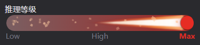
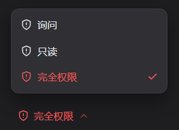

# dsh-ember

[](https://github.com/deepseek-ai/deepseek-harness)
[](#安装)
[](LICENSE)

**四件事，一个插件，不动任何官方组件。** 完全权限变红、推理等级变滑块、模型菜单补辨识度、会话列表加状态环。

- 每项功能**独立开关**，关掉立刻生效
- 纯前端，无服务端逻辑，装完重启即可



<p align="center"><sub>推理等级滑块 · Max 档（暗色主题）</sub></p>

> English readers: see [English](#english) below.

---

## 为什么

DSH 的界面有四处可以更好用：

1. **完全权限是灰色的。** 「完全权限」意味着智能体能直接执行敏感操作 —— 删文件、跑命令、改系统。它和「仅可查看」用同一个颜色，视觉上没有任何区别。
2. **推理等级是一串菜单项。** 想从 Low 调到 High，要点开菜单、找到那一行、点它。档位越多找得越慢，而且看不出「现在在整条阶梯的哪个位置」。
3. **模型菜单里认不出自己在哪。** 分组标题没有任何样式，滚动起来不知道当前是哪家 provider；选中的模型只有一个 14px 的对勾，官方 CSS 里明确写着 `background:0 0`（透明）—— 扫一眼落不下点。
4. **会话列表看不出谁在跑。** 运行中只有一个转圈的加载点，等你回答是黄点，完成是绿点。点很小，扫一眼列表分不出哪个需要你处理。

这个插件把这四处逐个补上，且每处都能单独关掉。

---

## 功能

### 1. 完全权限变红



- 「完全权限」的文字和盾牌图标都变成主题红
- **明暗主题都红**，各用 DSH 自带的危险色：亮色 `#ec1313`，暗色 `#f25a5a`
- 只在该预设被选中时红；切回「仅可查看」自动恢复原色
- 确认弹窗里的「启用完全权限」按钮**不会**被误染
- 输入区同排的其它芯片（如「电脑操作」）**不会**被误染：判据匹配宿主完整的 `访问模式，当前：{名称}` 模板，整串锚定，不是找关键词

### 2. 推理等级滑块

打开模型菜单，「推理等级」那一行下面**直接**就是滑块 —— 不用点进去：

```
┌──────────────────────────────┐
│ 模型        Deepseek-V4.1…  ›│
│ 推理等级                High ›│
│ [======|===============]     │  ← 滑块，停在当前档
│ Low        **High**       Max│  ← 档名当刻度，当前档加粗
└──────────────────────────────┘
```

- 档位**完全由上游下发决定**：读模型适配器报的 `efforts`，不写死
- **连续拖动，不是分段按钮**：滑块位置是浮点数，跟手走；拖动时只重画，松手才吸附到最近档并提交
- 1 / 2 / 3 / 4 / 6 档都验证过；只有 1 档时钉在右端并标 `aria-readonly`
- 拖动时刻度**即时高亮**
- 键盘方向键 / Home / End 同样可用
- 每档在旋钮背后画各自的余烬尾焰：档位越高，尾焰越长越热

### 3. 模型菜单可读性

模型菜单按官方尺寸（手机上也要用），所以这里**不动宽度**，改的是两处辨识：

```
┌──────────────────────────────┐
│ 搜索模型…                    │
├──────────────────────────────┤  ← 分组标题：14px 加粗 + 细分隔线
│ PROVIDER 名                  │    滚动时吸顶，自带不透明底
│                              │
│ ▢ Model-A · x0.8             │
│ ▣ Model-B · x0.12          ● │  ← 选中行：10% 洗色 + 2px 边 + 同色圆点
└──────────────────────────────┘
```

- **分组标题**加粗加大（12px → 14px / 700），下方一条细分隔线；sticky 时用主题自带的 `--dsw-alias-menu-group-header-fill` 铺底，否则下一组的行会从标题底下穿过去
- **当前模型**是一行**扁平**的选中态：电光蓝（`#0a84ff`）10% 透明度的洗色、2px 同色半透明边（55%）、模型名 600
- **没有渐变、没有高光、没有内阴影、没有光晕。** 现代系统 UI 靠单一强调色 + 一层洗色 + 一条干净的边来区分选中，不靠伪造的光影
- 原来的小对勾换成**同色实心圆点**（8px），和边框同色相 —— 「行被选中」与「点在这儿」是**一个信号**
- **宽度不变、行高不变、节点不增删**，移动端布局不受影响

### 4. 会话状态环

左侧会话列表里，每个会话的状态从行首那个小点变成**整行一圈边框**：

| 状态 | 环的形态 |
|---|---|
| 运行中 | 电光蓝短弧顺时针绕圈，4.2 秒一圈 |
| 等你回答 | 霓虹黄整圈呼吸，1.9 秒一个周期 |
| 完成未读 | 绿色整圈呼吸，同 1.9 秒周期 |
| 空闲 | 没有环 |

- 环贴在行自己的边界上（`inset:0`），和选中态背景共用同一条边
- 线宽 **2px**，**满饱和不混透明** —— 浅色主题下混透明会被行背景冲淡成米色，所以直接用不透明电光色
- 行首原来的小点**保留在 DOM 里**（无障碍 label 还在），只是完全透明，不影响布局也不影响读屏
- 拖拽排序时环自动让位给官方的落点指示线
- 尊重系统「减少动画」偏好：关掉动画后三种状态仍是可辨认的静态环

**「等你回答」和「完成未读」共用一个节奏、不共用颜色**：两者都是「这行有事」，所以呼吸同步；但黄表示「卡在你这儿」，绿表示「结果出来了」，两种事实不该用同一个颜色。

**「完成」是什么意思**：跟随宿主的 `completionUnread` —— 有结果你还没看，点开那个会话就消失。它不是「已跑完」的永久徽章。

**为什么环不直接读宿主的点**：宿主每行只渲染**一个**状态点，优先级是「等你 > 运行中 > 完成」。一个会话跑完了但还挂着一个待答问题时，宿主只会给出「等你」，完成这个事实根本没进 DOM，任何选择器都取不回来 —— 那正是「完成却显示黄色」的成因。所以环改读 `uiSession.sessionStatus`，三个事实各自独立可取，判定顺序为**运行中 > 完成 > 等你**：结果已经出来，比一个关于已结束轮次的问题更该被看见。`uiSession` 取不到时回落到宿主自己的点，环降级但不失效。

---

## 功能开关

插件详情页（**插件 → 已安装 → dsh-ember**）有四个开关。前三项**默认开启**，会话状态环**默认关闭**：

| 开关 | 对应功能 | 默认 |
|---|---|---|
| 完全权限变红 | 第 1 项 | 开 |
| 推理等级滑块 | 第 2 项 | 开 |
| 模型菜单可读性 | 第 3 项 | 开 |
| 会话状态环 | 第 4 项 | **关** |

会话状态环默认关闭的原因：它重绘的是整个侧边栏的每一行，而不是输入区的单个控件。这类改动适合由用户主动打开，不适合装完就出现。

- 关掉**立刻生效**，不需要重启
- 设置保存在本机浏览器的 `localStorage`（键 `dsh-ember:features`），换浏览器或清缓存会回到各自默认值
- 存储不可用或数据损坏时**回落到各自默认值**，不会导致插件失效

---

## 安装

```bash
dsh plugin add dsh-ember
```

也可以从 GitHub 直接装（会走源码构建）：

```bash
dsh plugin add https://github.com/REALOIYO/dsh-ember
```

或者先克隆到本地，再指向那个目录：

```bash
git clone https://github.com/REALOIYO/dsh-ember
dsh plugin add F:/path/to/dsh-ember
```

装完**重启 DSH**。这是纯前端插件，没有服务端逻辑。

---

## 兼容性

| 项 | 要求 |
|---|---|
| DSH | `0.2.1-rc.3`（在 `rc.3` 上开发与验证） |
| 菜单 | `[role="menu"][aria-label="模型与推理等级"]` |
| 依赖服务 | `slots` `sessions` `modelDirectories` `remote` `remote.session` |
| 平台 | Web（桌面端与局域网访问一致） |
| 浏览器内核 | Chromium 111+（用到 `:has()` 与 `color-mix()`） |

---

## 实现要点

### 红色：属性标记 + 一条 CSS

官方触发器的盾牌图标不写 `color`，用 `currentColor` 描边 —— 所以**给按钮上色，盾牌跟着变**。

插件用 `MutationObserver` 监听，当触发器同时满足「`aria-label` 含访问模式」和「含完全权限文案」时打上 `data-dsh-full-access`，再配一条规则：

```css
[data-dsh-full-access]{ color: var(--dsw-alias-state-error-primary) !important }
[data-dsh-full-access] svg{ color: inherit !important }
```

`--dsw-alias-state-error-primary` 在主题里本来就分开放（亮色 → `red-600`，暗色 → `red-400`），所以**不用自己挑色就自动跟随明暗**。

判据故意从严：两个条件都满足才动手 —— 官方哪天改了文案，结果是「不变红」而不是「染错按钮」。

### 滑块：读服务、写服务

用菜单的**无障碍名**定位，不用哈希类名（每次构建都变）：

```js
document.querySelectorAll('[role="menu"]')
  → aria-label 匹配 模型与推理等级
```

档位不是猜的，是**读模型适配器报的阶梯**：

```js
directory.store.getSnapshot()
→ snapshot.groups[i].models[j].reasoning.efforts
→ [{ id: 'low', name: 'Low' }, { id: 'high', name: 'High' }, …]
```

提交走 `directory.select()`，传完整三元组而不是裸档位 id：

```js
await directory.select({
  provider: current.provider,
  model: current.model,
  reasoningEffort: levelId,
});
```

三个设计决定：

- **为什么等存储确认**：`select()` 是异步的，快照在写入后仍会短暂回报旧档位。立刻采纳会让旋钮先吸附再弹回，所以本地记住目标档，等上游追上来再认账
- **为什么松手才提交**：拖动时只重画刻度与 `aria-valuetext`，不写数据。在 `pointermove` 里提交会打出十几次切换
- **为什么只注入不接管**：官方那两行原样保留，只是下方多了一个本插件写的块。官方菜单怎么渲染、定位、处理键盘，完全没动

### 状态环：读 `sessionStatus`，纯 CSS 画

宿主每行只渲染**一个**状态点，它选哪个由 `sessionStatuses()` 决定，顺序是「等你 > 运行中 > 完成」。这个顺序对点是对的 —— 它回答「为什么这行不能被忽略」；但它会让「跑完了但还挂着一个待答问题」的会话只剩 `warning`，**完成这个事实在进 DOM 之前就被丢掉了**，任何选择器都取不回来。这正是「完成却显示黄色」的成因。

环回答的是另一个问题：「这行的结果是什么」。所以它改读 `uiSession.sessionStatus`，那里 `running` / `pendingInteraction` / `completionUnread` 三个事实各自独立：

```
running            → ongoing（活的轮次永远优先，不能被遮）
completionUnread   → done   （结果已出来，比关于已结束轮次的问题更该被看见）
pendingInteraction → warning
其它               → 无环
```

判定结果写成 `data-dsh-ember-ring` 落在行上，CSS 只读这个属性：

```css
[data-row-key^="session:"][data-dsh-ember-ring~="ongoing"]::after { … }
[data-row-key^="session:"][data-dsh-ember-ring~="warning"]::after { … }
[data-row-key^="session:"][data-dsh-ember-ring~="done"]::after    { … }
```

- **状态变化不一定产生 DOM mutation**（跑完时宿主可能只就地换掉那个点），所以订阅 `sessionStatus`，变化时重跑一遍
- `uiSession` 取不到时回落到宿主自己的点，环降级（完成会并进黄色）但不失效
- `idle` 故意不写：没有环才是「无事发生」
- 环是绝对定位的伪元素 + mask 挖空中心，`pointer-events:none`，不改布局、不拦事件

### 开关：一个 style 标签一个功能

CSS 拆成四段，各自一个 `<style>` 标签。开关就是 `tag.disabled = true` —— 浏览器保留已解析规则，只停止应用，不重新解析也不增删 DOM。

配置读写全程 fail-open：`localStorage` 不可用、值损坏、或由旧版本写入（认得的功能更少），一律回落到各项自己的默认值（前三项开、状态环关）。

---

## 已知边界

- **依赖 `aria-label` 文案判定完全权限。** 官方若改文案（如「完整权限」），红色会失效但不会误染。修正位置：`lib/client.js` 的 `FULL_ACCESS_LABELS`
- **不处理 subagent 会话**（`available === false`），与官方选择器一致
- **菜单不可见时环境动画停止。** 宿主用 `display:none` / `visibility:hidden` / `opacity:0` 或移除节点关闭菜单时，循环都会自停，并在菜单重新可见后自行恢复
- **模型菜单的选中行样式靠属性推断。** 插件用三条选择器兜底（`[aria-checked="true"]` / `[data-selected]` / `[class*="_selected"]`）。三条都不命中时**静默无效果**，不会误染
- **分组标题靠 `data-menu-group-heading` 定位**，另有 `section[data-menu-group] > div:first-child` 兜底。官方若改属性名，结果是标题不再加粗，而不是样式串到别的元素上
- **选中行没有阴影是设计决定。** 列表是 `overflow-y:auto`，菜单是 `overflow:hidden`，向外画的阴影会被裁掉；用内阴影伪造景深正是前几版「油腻」的来源
- **电光蓝是写死的 `#0a84ff`，不走主题 token。** 主题自带的 business blue 是 `#4176e6`，在 10% 洗色下亮度不足。若要跟随主题，把 `rgba(10,132,255,…)` 换回 `var(--dsw-alias-state-business-primary)` 并调高 alpha
- **状态环配色是写死的电光值，不走主题 token。** 运行中 `#00a2ff`→`#beeeff` 梯度，等你 `#ffd400`，完成 `#22c55e`。之所以不用 `color-mix(… , transparent)` 降饱和：混透明会把颜色朝环背后的行填充混，浅色主题下无论比例多高都只能是米黄。深色主题下霓虹黄可能偏亮，如需分主题微调，改 `lib/client.js` 里 `css_ring` 的三条 `background`
- **状态环在扁矩形上快慢不均。** 短边只有 13~18 度却要走 32px，长边 162~167 度走 200px，像素速度差约 1.4 倍。已通过加长弧 + 放慢单圈摊薄，但几何根源无法消除

---

## 开发

```
lib/index.js       loader 入口（空实现，dsh.client 声明才让宿主加载 client.js）
lib/client.js      全部前端逻辑：CSS 注入、权限染色、滑块组件、状态环、功能开关
cordis.patch.yml   profile patch 层，插入一个 loader entry
docs/              探测报告与验证记录
```

离线验证台在 `_tmp/`（不在包内）：用真实 DOM 复现会话行与 composer 行，不连 DSH 即可检查状态环与滑块。

> 验证台是开发用的临时产物，不随包发布；装好插件后不需要它。

---

## 许可

MIT

---
---

# English

[](https://github.com/deepseek-ai/deepseek-harness)
[](#install)
[](LICENSE)

**Four things, one plugin, no shipped component replaced.** Full access turns red, reasoning effort becomes a slider, the model picker gains bearings, and the session list gets a status ring.

- Every feature has its **own switch**; turning one off takes effect immediately
- Browser-only, no host-side logic; restart after installing


<p align="center"><sub>Effort slider at the top rung · dark theme</sub></p>

---

## Why

Four spots in DSH could read better:

1. **Full access is grey.** It permits destructive operations — deleting files, running commands, touching the system — yet it looks exactly like read-only.
2. **Effort is a list of menu rows.** Going from Low to High means opening a menu and hunting for the row. More rungs, more hunting, and no sense of where you sit on the ladder.
3. **The model picker gives you no bearings.** Group headings have no styling of their own, so once the list scrolls you lose track of which provider you are in; the selected row carries only a 14px check mark, and the shipped CSS is explicitly `background:0 0`.
4. **The session list does not say who is running.** A spinning dot while running, a yellow dot when it waits on you, a green dot when done. They are tiny; scanning the list tells you nothing about which row needs attention.

This plugin fixes all four, and each one can be switched off on its own.

---

## Features

### 1. Full access in red


- The label and the shield glyph both take the theme's danger colour
- **Red in both themes**, using DSH's own tokens: `#ec1313` light, `#f25a5a` dark
- Red only while that preset is current; switching back restores the neutral tone
- The confirmation dialog's “Enable full access” button is deliberately left alone

### 2. Reasoning effort slider

Open the model menu and the slider is **right there** under the effort row — no drilling in:

```
┌──────────────────────────────┐
│ Model       Deepseek-V4.1…  ›│
│ Effort                  High ›│
│ [======|===============]     │  ← the slider, parked on the current rung
│ Low        **High**       Max│  ← rung names as the scale, current in bold
└──────────────────────────────┘
```

- Ladder length comes from the model adapter's own `efforts`, never hard-coded
- **Continuously draggable, not a row of segmented buttons**: the position is a float that follows the pointer; dragging only repaints, and the knob snaps to the nearest rung and commits on release
- 1 / 2 / 3 / 4 / 6 rungs verified; with a single rung the knob parks at the right end and the rail is marked `aria-readonly`
- The scale highlights live while dragging
- Arrow keys, Home and End work as well
- Each rung paints its own ember plume behind the knob: higher rungs burn longer and hotter

### 3. Model picker legibility

The picker is width-capped on purpose (it also has to work on a phone), so this **changes no geometry** — it adds contrast in two places:

```
┌──────────────────────────────┐
│ Search models…               │
├──────────────────────────────┤  ← group heading: 14px bold + hairline rule
│ PROVIDER NAME                │    sticks while scrolling, opaque bed
│                              │
│ ▢ Model-A · x0.8             │
│ ▣ Model-B · x0.12          ● │  ← selected: 10% wash + 2px edge + same-colour dot
└──────────────────────────────┘
```

- **Group headings** go bold and up a size (12px → 14px / 700) with a rule beneath, and get the theme's own `--dsw-alias-menu-group-header-fill` bed so rows do not scroll through the sticky title
- **The selected row** is a **flat** state built from exactly three things: a 10% wash of electric blue (`#0a84ff`), a 2px half-transparent edge of the same colour (55%), and a semibold name
- **No gradients, no highlights, no inner shadows, no glow.** Modern system UI separates a selected state with one accent, one wash and one clean edge — not with faked light
- The shipped check mark becomes a **same-colour solid dot** (8px). Sharing the accent with the row edge makes “this row is selected” and “the mark is here” **one signal**
- **No width change, no row-height change, no nodes added or removed**, so the mobile layout is untouched

### 4. Session status ring

In the left session list, each session's state moves from a dot at the row's leading edge to **a ring around the whole row**:

| State | What the ring does |
|---|---|
| Running | A short electric-blue arc travels clockwise, one lap every 4.2s |
| Waiting on you | The whole ring breathes in neon yellow, 1.9s a cycle |
| Done (unread) | The whole ring breathes in green, same 1.9s cycle |
| Idle | No ring |

- The ring sits flush on the row's own paint box (`inset:0`), sharing the edge the selection highlight uses
- **2px** wide, painted at **full saturation with no transparency mix** — mixing toward transparent blends against whatever sits behind the ring, which on a light theme is a near-white row, so any ratio above zero washed out to beige
- The leading dot **stays in the DOM** with its accessibility label, painted fully transparent — no layout shift, no loss for screen readers
- During drag-reorder the ring yields to the host's own drop indicator
- Respects `prefers-reduced-motion`: with motion off, all three states remain legible as static rings

**Waiting and done share one rhythm, not one colour**: both mean "there is something here for you", so they breathe at the same tempo — but yellow is "blocked on you" while green is "the result is here", and two different facts should not share a colour.

**What “done” means**: it follows the host's `completionUnread` — there is a result you have not looked at, and it clears the moment you open that session. It is not a permanent “finished” badge.

---

## Switches

The plugin detail page (**Plugins → Installed → dsh-ember**) carries four switches. The first three are **on by default**; the session status ring is **off**:

| Switch | Feature | Default |
|---|---|---|
| Full access in red | Feature 1 | on |
| Reasoning effort slider | Feature 2 | on |
| Model picker legibility | Feature 3 | on |
| Session status ring | Feature 4 | **off** |

The ring ships off because it repaints every row of the sidebar rather than a single control in the composer. A change that wide is one a user should opt into, not discover.

- Turning one off takes effect **immediately**; no restart
- The setting lives in the browser's `localStorage` (key `dsh-ember:features`); another browser or a cleared cache falls back to each feature's own default
- If storage is unavailable or the value is corrupt, **each feature falls back to its own default** — the plugin never disables itself

---

## Install

```bash
dsh plugin add dsh-ember
```

Or straight from GitHub (builds from source):

```bash
dsh plugin add https://github.com/REALOIYO/dsh-ember
```

Or clone it first and point at the directory:

```bash
git clone https://github.com/REALOIYO/dsh-ember
dsh plugin add F:/path/to/dsh-ember
```

Then **restart DSH**. It is browser-only; there is no host-side logic.

---

## Compatibility

| Item | Requirement |
|---|---|
| DSH | `0.2.1-rc.3` (developed and verified on `rc.3`) |
| Menu | `[role="menu"][aria-label="Model and reasoning effort"]` |
| Services | `slots` `sessions` `modelDirectories` `remote` `remote.session` |
| Platform | Web (desktop and LAN access behave the same) |
| Engine | Chromium 111+ (uses `:has()` and `color-mix()`) |

---

## How it works

### Red: one attribute plus one CSS rule

The shipped trigger's shield glyph carries no `color` of its own and strokes with `currentColor` — so **colour the button and the shield follows**.

A `MutationObserver` tags the trigger with `data-dsh-full-access` when it matches both “`aria-label` looks like the access trigger” and “contains the full-access copy”, then one rule applies:

```css
[data-dsh-full-access]{ color: var(--dsw-alias-state-error-primary) !important }
[data-dsh-full-access] svg{ color: inherit !important }
```

`--dsw-alias-state-error-primary` is already split per theme (light → `red-600`, dark → `red-400`), so **the colour follows the theme without being picked here**.

The predicate is deliberately strict: both conditions must hold — if the host renames the copy, the result is “no red” rather than “the wrong button painted”.

### Slider: read the service, write the service

The menu is located by its **accessible name**, never a hashed class (those change every build):

```js
document.querySelectorAll('[role="menu"]')
  → aria-label matches “Model and reasoning effort”
```

The rungs are not guessed; they are **read from the ladder the model adapter reports**:

```js
directory.store.getSnapshot()
→ snapshot.groups[i].models[j].reasoning.efforts
→ [{ id: 'low', name: 'Low' }, { id: 'high', name: 'High' }, …]
```

Commits go through `directory.select()`, passing the full triple rather than a bare rung id:

```js
await directory.select({
  provider: current.provider,
  model: current.model,
  reasoningEffort: levelId,
});
```

Three deliberate decisions:

- **Why wait for the store to agree**: `select()` is async and the snapshot briefly keeps reporting the old rung. Adopting it immediately makes the knob snap to the new rung and bounce back, so the target rung is remembered locally and acknowledged once the upstream catches up
- **Why commit on release only**: during a drag the plugin repaints the scale and `aria-valuetext` but writes no data. Committing inside `pointermove` would fire a dozen switches per drag
- **Why inject rather than take over**: the two shipped rows stay exactly as they are; one block authored by this plugin is appended below the effort row. How the host menu renders, positions and handles the keyboard is untouched

### Status ring: reads `sessionStatus`, paints in CSS

The host renders exactly **one** status dot per row, chosen by `sessionStatuses()` in the order waiting > running > completed. That order is right for a dot — it answers "why can this row not be ignored" — but it makes a session that finished while a question is still open report only `warning`. The completion is dropped before it ever reaches the DOM, so no selector can recover it. That is what made a finished run show up yellow.

The ring answers a different question: "what is this row's outcome". So it reads `uiSession.sessionStatus`, which holds `running` / `pendingInteraction` / `completionUnread` independently:

```
running            → ongoing  (a live turn always wins; never masked)
completionUnread   → done     (a result that exists outranks a question about a turn that already ended)
pendingInteraction → warning
otherwise          → no ring
```

The verdict is published on the row as `data-dsh-ember-ring`, and the CSS reads only that:

```css
[data-row-key^="session:"][data-dsh-ember-ring~="ongoing"]::after { … }
[data-row-key^="session:"][data-dsh-ember-ring~="warning"]::after { … }
[data-row-key^="session:"][data-dsh-ember-ring~="done"]::after    { … }
```

- **A state change does not always produce a DOM mutation** (the host may swap the dot in place), so the plugin subscribes to `sessionStatus` and re-runs the pass on change
- When `uiSession` is unavailable the ring falls back to the host's own dot: degraded (done folds into yellow) but never broken
- `idle` is absent on purpose: no ring IS "nothing to see"
- The ring is an absolutely positioned pseudo-element with a masked-out centre and `pointer-events:none` — it changes no layout and intercepts no events

### Switches: one style tag per feature

The CSS is split into four sections, each installed as its own `<style>` tag. Switching a feature off is `tag.disabled = true` — the browser keeps the parsed rules and simply stops applying them, so nothing is re-parsed and nothing is added to or removed from the DOM.

Reading and writing the setting fails open at every step: no `localStorage`, a corrupt value, or a value written by an older version that knew fewer features all resolve to “everything on”.

---

## Known limits

- **Full access detection depends on the `aria-label` copy.** If the host renames it (e.g. to a different word for full access), the red silently stops applying rather than painting the wrong control. Fix location: `FULL_ACCESS_LABELS` in `lib/client.js`
- **Subagent sessions are not handled** (`available === false`), matching the shipped picker
- **Ambient animation stops while the menu is hidden.** When the host closes the menu with `display:none` / `visibility:hidden` / `opacity:0` or by removing the node, the loop parks itself and resumes once the menu is visible again
- **The selected-row style infers its target from attributes.** Three selectors are tried (`[aria-checked="true"]` / `[data-selected]` / `[class*="_selected"]`). When none matches, the result is **silence**, never a mispainted row
- **Group headings are located via `data-menu-group-heading`**, with `section[data-menu-group] > div:first-child` as a fallback. If the host renames the attribute the headings simply stop bolding — the styles never leak onto another element
- **The selected row has no shadow, by design.** The list is `overflow-y:auto` and the menu is `overflow:hidden`, so an outer shadow would be clipped; faking depth with an inner shadow is exactly what read as greasy in earlier versions
- **Electric blue is a hard-coded `#0a84ff`, not a theme token.** The theme's own business blue is `#4176e6`, which is too dim under a 10% wash. To follow the theme instead, swap `rgba(10,132,255,…)` back to `var(--dsw-alias-state-business-primary)` and raise the alpha
- **The ring's colours are hard-coded electric values, not theme tokens.** Running uses a `#00a2ff` → `#beeeff` gradient; waiting uses `#ffd400`; done uses `#22c55e`. `color-mix(… , transparent)` was deliberately avoided: mixing toward transparent blends against whatever sits behind the ring, which on a light theme is a near-white row, so no ratio above zero could avoid washing out to beige. On a dark theme the neon yellow may read as too bright — to tune per theme, edit the three `background` declarations in `css_ring` in `lib/client.js`
- **The ring runs unevenly on a flat box.** The two short edges span only 13–18deg while the long ones span 162–167deg, so pixel speed differs by about 1.4x. Lengthening the arc and slowing the lap spreads the difference out, but the geometric cause cannot be removed

---

## Development

```
lib/index.js       loader entry (empty; the dsh.client declaration is what makes the host load client.js)
lib/client.js      all browser logic: CSS injection, permission repaint, slider, status ring, feature switches
cordis.patch.yml   profile patch layer, inserts one loader entry
docs/              probe reports and verification records
```

An offline harness lives in `_tmp/` (not shipped): it reproduces the session row and the composer row with real DOM, so the ring and the slider can be checked without connecting to DSH.

> The harness is a development artefact and is not published; it is not needed once the plugin is installed.

---

## License

MIT
